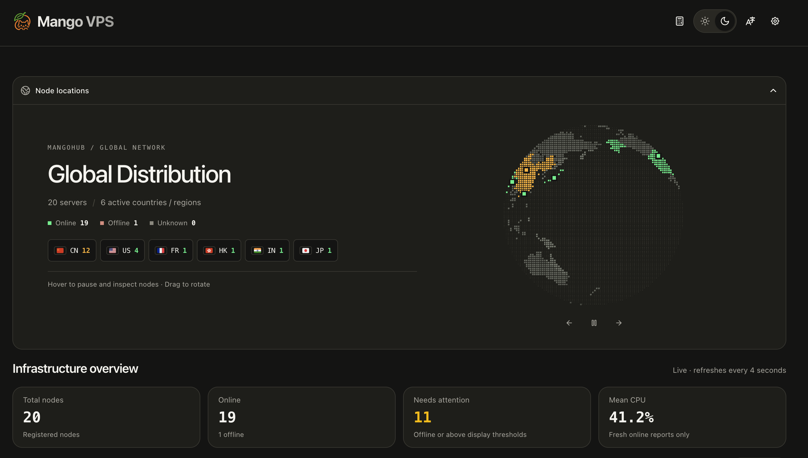

# Mangohub (简体中文)

[English](./README.md) | [简体中文](./README_zh-cn.md)



**Mangohub** 是一套面向云原生与边缘基础设施的企业级可观测与运维管控平台。平台由高频低损耗的节点探针（`agent`）与集中控制面板（`hub`）构成，提供全维实时监控、零信任 Fleet SSH 凭据金库、边缘自适应防爆破限流、高精度磁盘 IO 剖析及算力任务管控能力。

---

## 🌟 核心特性

### 1. 超低损耗高频指标采集与深度观测
- **亚秒级实时推送**：极低系统资源占用，毫秒级指标聚合上报。
- **高精度磁盘 IO 监控**：基于 `/proc/diskstats` 深度采集多块盘读写吞吐、IOPS，挂载点与实际物理/虚拟块设备智能映射。
- **分层 cgroup v2 与容器配额感知**：深度兼容 Docker、Podman、LXC 与 Pterodactyl 配额体系，防止容器 CPU 抑制（clamp）导致的误报。
- **多路径连通性追踪**：支持 ICMP、TCP、系统原生 Ping 及 HTTP 代理连通性探测，自适应自定义 DNS 解析器。

### 2. Fleet SSH 零信任凭据金库与动态租约
- **PBKDF2 强加密保险箱**：支持一次性临时密钥对签发，凭据在内存与存储全链路强加密。
- **动态租约注入与自动吊销**：主控下发短期 SSH 租约，客户端探针原子写入 `authorized_keys`，到期自愈清理，防止凭据泄露残留。
- **StrictModes 与 Windows ACL 硬化**：严格遵循 OpenSSH 权限模型，Windows 环境下自动校验并硬化安全访问控制列表（ACL）。
- **内置网页终端**：基于 PTY / Windows ConPTY 的低延迟网页交互终端。

### 3. 边缘防御与访问控制
- **自适应防爆破限流**：识别 Cloudflare 等反向代理穿透后的真实客户端 IP，滑动窗口拦截针对管理后台与 API 的暴力破解。
- **细粒度角色权限**：严密隔离公开仪表盘只读展示、节点管理与动态提权工单。

### 4. 算力与硬件负载深度监管
- **高频硬件遥测**：内置矿工与计算负载（如 SRBMiner）实时数据采集器，聚合哈希率、功耗与核心温度。
- **进程树安全生命周期管控**：支持远程安全启停，带超时防护的进程组终止与僵尸进程清理。

### 5. 新一代 3D 沉浸式交互面板
- **内置自研 Deer 主题**：现代化 Next.js 前端深度内嵌于二进制中，单文件分发，零外部依赖。
- **3D 正交地球仪可视化**：直观展示全球节点地理分布、实时延迟及部分网络故障状态。
- **响应式控制台**：支持资源曲线抽屉预览、多视图排版（表格/网格）与主题自定义配置。

---

## 🏗️ 仓库结构

本项目采用统一 Monorepo 组织结构：

```text
mangohub/
├── agent/            # 节点探针与零信任执行守护进程
│   ├── cmd/          # Cobra 命令行接口
│   ├── monitoring/   # 指标收集核心（CPU、内存、磁盘 IO、网络、Ping）
│   ├── sshauth/      # 零信任 authorized_keys 租约与 ACL 硬化
│   ├── terminal/     # 交互式网页终端桥接
│   └── update/       # 客户端自更新流水线
├── hub/              # 集中控制主服务与 Web 面板
│   ├── cmd/          # 服务端启动与维护 CLI 命令
│   ├── database/     # SQLite / MySQL / PostgreSQL 数据库模型
│   ├── internal/     # 服务端核心（SSH 金库、防爆破限流器、鉴权中间件）
│   ├── pkg/          # RPC 通信协议、JS 运行时引擎、指标处理引擎
│   └── web/          # 静态资源服务与内置 Deer 主题
├── go.work           # Go 多模块工作区配置
├── Makefile          # 统一构建与测试入口
└── LICENSE           # MIT 开源许可证
```

---

## 🚀 快速上手

### 环境要求
- Go 1.24+（运行 Hub 推荐 Go 1.25+）
- Node.js 20+（仅在重新构建前端静态资源时需要）
- GCC / Clang / Zig（用于编译支持 SQLite 的 CGO 二进制）

### 1. 编译源码

```bash
# 克隆仓库
git clone https://github.com/dengyie/mangohub.git
cd mangohub

# 一键编译 Agent 与 Hub
make all

# 或按需单独编译：
make hub      # 输出路径: ./bin/mangohub
make agent    # 输出路径: ./bin/mango-agent
```

### 2. 运行 Mangohub 主控服务端

```bash
# 启动服务端（默认使用 SQLite 数据库）
./bin/mangohub server

# 自定义监听地址
MANGOHUB_LISTEN="0.0.0.0:25774" ./bin/mangohub server
```

启动完成后即可在浏览器访问 `http://localhost:25774` 进入控制面板。

### 3. 部署 Mango Agent 探针

```bash
./bin/mango-agent --endpoint "http://your-hub-ip:25774" --token "your-agent-token"
```

---

## 📄 许可证

Mangohub 遵循 [MIT 开源许可证](./LICENSE)。
